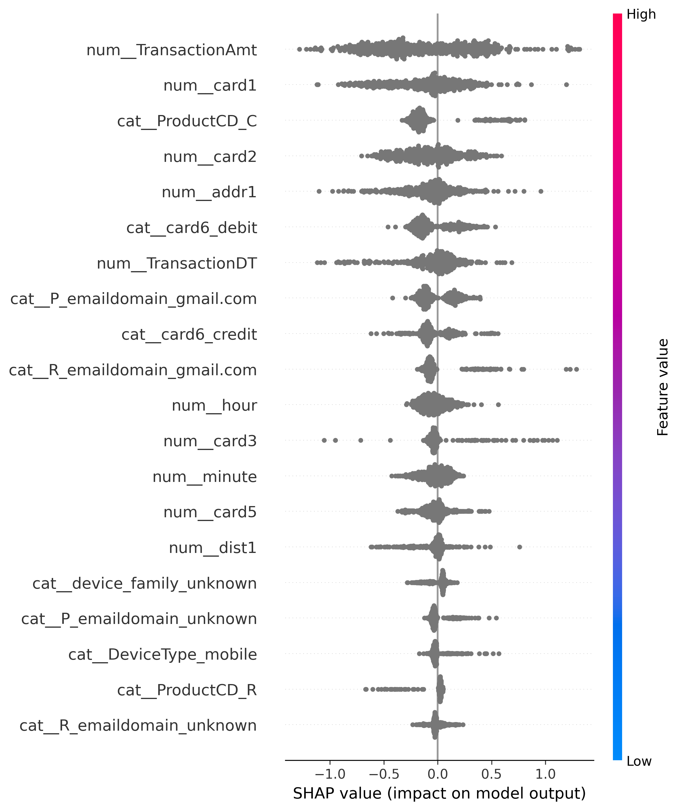
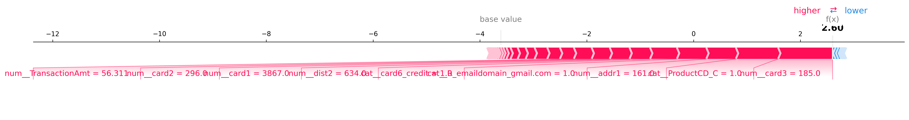

# 🛡️ FraudShield — Transaction Fraud Detection & Risk Analysis System

FraudShield is an end-to-end machine learning project for detecting potentially fraudulent transactions and analyzing transaction risk.

The project combines **machine learning, feature engineering, imbalanced classification, threshold analysis, SHAP explainability, and a Streamlit application** into a single fraud-risk analysis system.

> **Note:** FraudShield is a portfolio/research prototype. It is not connected to any real bank, payment network, or financial account.

---

## 🚀 Project Overview

Financial fraud detection is a highly imbalanced classification problem where fraudulent transactions represent only a small portion of all transactions.

FraudShield explores how machine learning can be used to identify suspicious transactions while also providing explanations for model predictions.

The project contains two complementary application modes:

### 🔬 Research Dashboard

Uses the trained **XGBoost model** with the technical features used during model development.

### 💳 Transaction Simulator

Provides a realistic, human-friendly transaction interface where users can simulate everyday payments and observe how different risk signals affect a transaction's risk score.

The simulator is intentionally rule-based and is **not presented as an XGBoost prediction**.

---

## 🎯 Project Objectives

- Understand transaction fraud data
- Perform exploratory data analysis
- Analyze severe class imbalance
- Engineer useful transaction and device features
- Build a Logistic Regression baseline
- Train an XGBoost fraud detection model
- Compare different modeling approaches
- Analyze classification thresholds
- Use SHAP for model explainability
- Build a transaction risk scoring interface
- Develop an interactive Streamlit application
- Package the project as a reproducible ML portfolio project

---

## 🧠 Machine Learning Workflow

```text
IEEE-CIS Fraud Detection Dataset
                ↓
        Data Understanding
                ↓
     Exploratory Data Analysis
                ↓
       Feature Engineering
                ↓
        Data Preprocessing
                ↓
    Logistic Regression Baseline
                ↓
            XGBoost
                ↓
    Class Imbalance Analysis
                ↓
       Threshold Analysis
                ↓
      SHAP Explainability
                ↓
       Risk Assessment
                ↓
      Streamlit Application
```

---

## 📊 Dataset

FraudShield uses the **IEEE-CIS Fraud Detection** dataset.

The original competition data contains transaction-level information together with identity-related information.

The project uses:

- `train_transaction.csv`
- `train_identity.csv`

The original transaction dataset contains hundreds of technical and anonymized features.

For this project, a smaller feature set was selected for the initial modeling pipeline rather than blindly using every available column.

### Important Dataset Note

The model development in this project uses a **50,000-row development subset** of the transaction data.

The raw dataset files are **not included in this GitHub repository** because of their size and dataset/distribution considerations.

---

## ⚙️ Feature Engineering

Several useful features were derived from the original transaction signals.

### Time Features

`TransactionDT` was transformed into:

- `day_index`
- `hour`
- `minute`

This allows the model to capture temporal patterns.

### Identity Availability

A binary feature called:

```text
has_identity
```

was created to indicate whether identity information was available for a transaction.

### Device Features

The original device information was supplemented with a simplified:

```text
device_family
```

feature.

Examples include:

- Windows
- iOS
- Mac
- Android
- Samsung
- Trident
- Chrome
- Firefox
- Other

---

## 🧩 Model Features

The final modeling pipeline uses 21 selected features.

### Numerical Features

```text
TransactionDT
TransactionAmt
card1
card2
card3
card5
addr1
addr2
dist1
dist2
day_index
hour
minute
has_identity
```

### Categorical Features

```text
ProductCD
card4
card6
P_emaildomain
R_emaildomain
DeviceType
device_family
```

Categorical features are handled using one-hot encoding, while numerical features are imputed where necessary.

---

## 🤖 Models

### 1. Logistic Regression

Logistic Regression was used as the baseline classification model.

The baseline achieved approximately:

| Metric | Score |
|---|---:|
| ROC-AUC | 0.770 |
| PR-AUC | 0.127 |

The baseline helped establish a reference point before using a more powerful tree-based model.

---

### 2. XGBoost

XGBoost was selected as the main model because tree-based boosting models can capture nonlinear relationships and interactions between transaction features.

The primary XGBoost model achieved:

| Metric | Score |
|---|---:|
| ROC-AUC | **0.903** |
| PR-AUC | **0.581** |

These results were obtained using a 50,000-row development subset and a single stratified 80/20 train-test split.

---

## 📈 Model Comparison

| Model | ROC-AUC | PR-AUC |
|---|---:|---:|
| Logistic Regression | 0.770 | 0.127 |
| XGBoost | **0.903** | **0.581** |
| Tuned XGBoost | 0.892 | 0.549 |
| Imbalance-Aware XGBoost | 0.898 | 0.515 |

The original XGBoost configuration performed best among the tested configurations on the selected evaluation split.

---

## ⚖️ Class Imbalance

Fraud detection is highly imbalanced.

In the 50,000-row development subset, legitimate transactions greatly outnumbered fraudulent transactions.

This means accuracy alone is not an appropriate metric for evaluating the system.

FraudShield therefore focuses on metrics such as:

- ROC-AUC
- PR-AUC
- Precision
- Recall
- F1-score
- Confusion Matrix

Threshold analysis was also performed to understand the trade-off between detecting more fraud and generating more false positives.

---

## 🎚️ Threshold Analysis

The default classification threshold is not always the best choice for fraud detection.

For the primary XGBoost model, different thresholds were evaluated.

Example:

| Threshold | Precision | Recall | F1 |
|---:|---:|---:|---:|
| 0.10 | 0.404 | 0.605 | 0.484 |
| 0.20 | **0.608** | 0.520 | **0.561** |
| 0.30 | 0.763 | 0.439 | 0.557 |
| 0.50 | 0.944 | 0.251 | 0.397 |

A threshold around **0.20** produced the highest tested F1-score in this analysis.

This demonstrates an important fraud-detection concept:

> Lowering the threshold can increase fraud detection recall, but may also increase false positives.

---

## 🔎 Explainable AI with SHAP

FraudShield uses **SHAP (SHapley Additive exPlanations)** to understand the contribution of individual features to model predictions.

This allows the system to move beyond simply saying:

> "This transaction is suspicious."

and instead investigate:

> "Which model signals contributed to this prediction?"

Example SHAP outputs include:

- Global feature importance
- Individual transaction explanations
- Positive and negative feature contributions

### SHAP Summary



### Fraudulent Transaction Explanation



---

## 🖥️ Streamlit Application

FraudShield includes an interactive Streamlit application with three main sections.

### 🏠 Dashboard

The research dashboard allows users to enter the technical transaction features expected by the trained model.

It provides:

- Fraud probability
- Risk score
- Risk level
- Recommendation
- SHAP explanation
- Top model signals

---

### 💳 Transaction Simulator

The simulator provides a more realistic everyday transaction interface.

Users can simulate:

- Transaction amount
- Payment method
- Merchant category
- Transaction type
- Location
- Domestic/international transaction
- Device
- New device
- New merchant
- Recent transaction frequency
- Distance from usual location
- Transaction time

The simulator generates:

- Transaction ID
- Analysis timestamp
- Risk score
- Risk level
- Processing recommendation
- Security checks
- Risk factors
- Protective signals
- Transaction summary

### Important

The simulator uses a **transparent rule-based risk engine**.

It does **not** use the XGBoost model and does not claim to produce calibrated fraud probabilities.

This separation keeps the application realistic while avoiding misleading claims about the anonymized IEEE-CIS features.

---

### 🤖 About Model

The About Model page explains:

- Project objective
- Dataset
- Model performance
- ML pipeline
- Feature groups
- SHAP explainability
- Risk classification
- Real-world deployment considerations

---

## 🚦 Risk Classification

The application currently uses the following risk-score categories:

| Risk Score | Risk Level | Recommendation |
|---:|---|---|
| `< 30` | 🟢 Low Risk | Normal Processing |
| `30 – 59.99` | 🟡 Medium Risk | Review Transaction |
| `≥ 60` | 🔴 High Risk | Investigate Transaction |

These thresholds are **application-level heuristics** and are not bank-approved fraud thresholds.

---

## 🏗️ Project Structure

```text
FraudShield/
│
├── Data/
│   └── raw/
│       ├── train_transaction.csv
│       └── train_identity.csv
│
├── notebooks/
│   └── 01_Data_Inspection.ipynb
│
├── models/
│   └── fraudshield_xgb_model.pkl
│
├── images/
│   ├── shap_summary.png
│   └── shap_fraud_transaction.png
│
├── app/
│   └── app.py
│
├── README.md
├── requirements.txt
└── .gitignore
```

The raw dataset files are excluded from Git using `.gitignore`.

---

## 🛠️ Technologies Used

### Programming

- Python

### Machine Learning

- Scikit-learn
- XGBoost

### Data Processing

- Pandas
- NumPy

### Explainable AI

- SHAP

### Visualization

- Matplotlib

### Application

- Streamlit

### Model Persistence

- Joblib

### Development

- Jupyter Notebook
- VS Code

---

## ⚙️ Installation

Clone the repository:

```bash
git clone https://github.com/anantrai3127/FraudShield.git
```

Move into the project directory:

```bash
cd FraudShield
```

Install the required packages:

```bash
pip install -r requirements.txt
```

---

## ▶️ Running the Application

Navigate to the application directory:

```bash
cd app
```

Run Streamlit:

```bash
python -m streamlit run app.py
```

The application will open in your browser.

---

## 📓 Running the Notebook

The main notebook is:

```text
notebooks/01_Data_Inspection.ipynb
```

The notebook covers:

- Dataset inspection
- Missing-value analysis
- Target distribution
- Feature exploration
- Transaction/identity merging
- Feature engineering
- Preprocessing
- Logistic Regression
- XGBoost
- Threshold analysis
- Feature importance
- SHAP analysis
- Model saving

---

## 🔐 Real-World Considerations

A production fraud detection system would require significantly more infrastructure than this portfolio prototype.

A real deployment would require:

- Bank-specific historical transaction data
- Secure payment infrastructure
- Model calibration
- Continuous model monitoring
- Fraud feedback loops
- Concept drift detection
- False-positive monitoring
- Data-quality monitoring
- Secure feature pipelines
- Access control
- Encryption
- Audit logging
- Model retraining
- Human fraud-review workflows

The anonymized IEEE-CIS features should not be assumed to directly represent real-world banking fields.

---

## ⚠️ Limitations

This project has several important limitations:

1. The model was developed using a 50,000-row subset rather than the complete dataset.
2. Reported metrics come from a single 80/20 stratified evaluation split.
3. The IEEE-CIS dataset contains anonymized features.
4. The model is not trained on real bank-specific data.
5. Application risk thresholds are heuristic.
6. The Transaction Simulator is rule-based rather than ML-based.
7. The application is not connected to real financial accounts or payment networks.
8. The model should not be interpreted as a production-ready banking fraud detector.

---

## 🔮 Future Improvements

Possible future improvements include:

- Train using a much larger portion of the dataset
- Time-based validation
- Cross-validation
- Probability calibration
- More advanced feature engineering
- LightGBM comparison
- Better fraud threshold optimization
- Real-time inference API using FastAPI
- Docker deployment
- Model monitoring
- Data drift detection
- Automated retraining pipeline
- Production-grade authentication
- Cloud deployment
- Human fraud-review workflow

---

## 📌 Key Learning Outcomes

Through this project, I worked with:

- End-to-end ML project structure
- Large tabular datasets
- Data merging
- Missing-value handling
- Categorical encoding
- Feature engineering
- Imbalanced classification
- Logistic Regression
- XGBoost
- Precision/Recall trade-offs
- Threshold optimization
- ROC-AUC and PR-AUC
- SHAP explainability
- Model serialization
- Streamlit application development
- Risk scoring
- ML project documentation

---

## 👨‍💻 Author

**Anant Rai**

AI/ML Student

GGSIPU

---

## 📄 Disclaimer

FraudShield is an educational and portfolio project created for machine learning research and demonstration.

It does not process real payments, connect to bank accounts, authorize transactions, or provide financial advice.

The risk scores and recommendations shown by the application should not be used for real financial decisions.