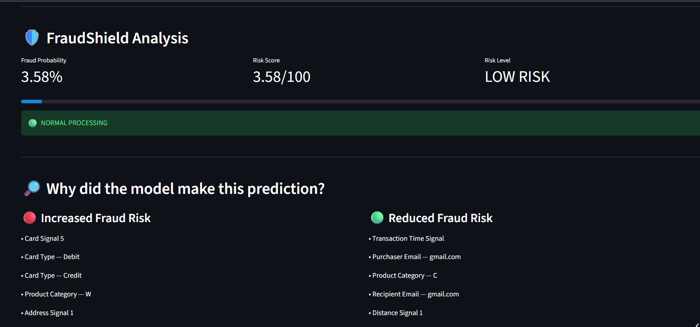
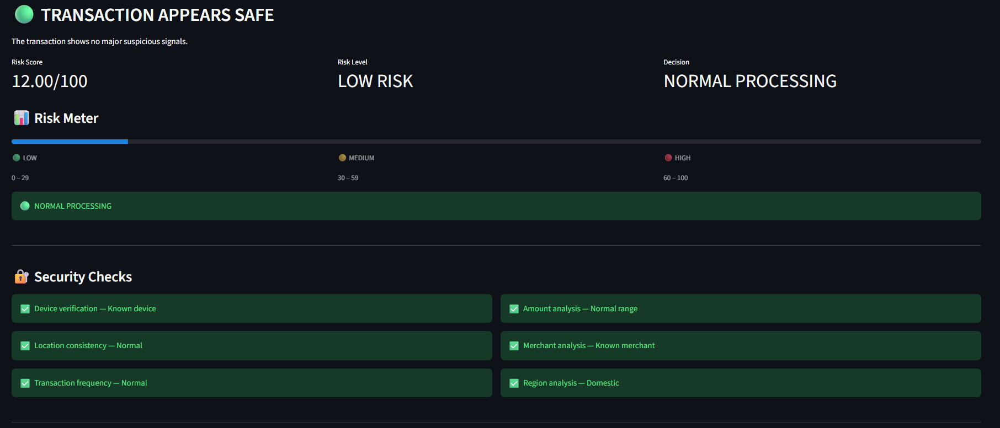
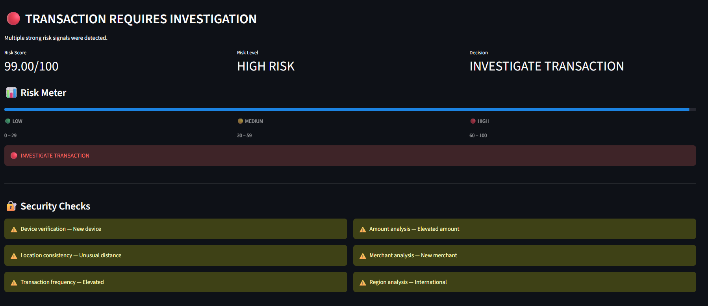
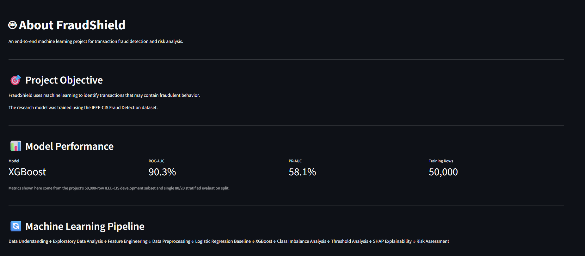

# 🛡️ FraudShield — AI-Powered Fraud Detection System

**FraudShield** is an end-to-end machine learning project for detecting potentially fraudulent financial transactions using **XGBoost**.

The project combines **machine learning, fraud-risk analysis, model explainability, and an interactive Streamlit application** to demonstrate how an AI-based fraud detection system can identify suspicious transaction patterns.

> ⚠️ **Disclaimer:** FraudShield is an educational and portfolio project. It does not connect to real banking or payment networks and should not be used for real financial decisions.

---

## 🚀 Live Demo

🌐 **Streamlit Application:**  
https://fraudshield-4dhscbi9u2uanmbe2cgkvy.streamlit.app/

---

## 🎯 Project Objective

FraudShield aims to build an ML-based system that can:

- Detect potentially fraudulent transactions
- Estimate fraud probability
- Assign a transaction risk level
- Identify important factors influencing predictions
- Analyze different transaction-risk scenarios
- Provide interpretable model predictions using SHAP
- Demonstrate an end-to-end ML deployment workflow

---

## 🤖 Machine Learning Model

FraudShield uses **XGBoost** as the primary classification model.

### Model Performance

| Metric | Score |
|---|---:|
| **ROC-AUC** | **90.3%** |
| **PR-AUC** | **58.1%** |

The model generates a probability indicating how likely a transaction is to be fraudulent. This probability is then used for risk-oriented analysis within the application.

---

## 🔄 Machine Learning Pipeline

```text
Raw Transaction Data
        ↓
Data Preprocessing
        ↓
Feature Engineering
        ↓
Train / Test Split
        ↓
XGBoost Classifier
        ↓
Fraud Probability
        ↓
Risk Analysis
        ↓
SHAP Explainability
        ↓
Streamlit Application
```

---

## 🧠 How FraudShield Works

### 1. Transaction Input

The system receives transaction-related information containing financial and behavioral signals.

### 2. Data Processing

Input data is processed using the same general preprocessing approach used during model development.

### 3. XGBoost Prediction

The trained XGBoost classifier generates a probability representing the likelihood that a transaction is fraudulent.

### 4. Risk Assessment

The prediction is presented through an easy-to-understand risk-oriented interface.

### 5. Explainability

**SHAP (SHapley Additive exPlanations)** is used to understand which features contributed toward increasing or decreasing the model's prediction.

---

# 🚀 Streamlit Application

FraudShield provides an interactive Streamlit application with multiple sections.

## 1. ML Fraud Analysis Dashboard

The dashboard uses the trained XGBoost model to analyze a transaction and display:

- Fraud probability
- Risk score
- Risk level
- Prediction result
- Model explanation
- Increased fraud-risk signals
- Reduced fraud-risk signals

### Dashboard



---

## 2. Transaction Risk Simulator

The simulator allows users to experiment with different transaction scenarios and observe how different risk signals affect the resulting risk score.

### Low-Risk Example



**Example:**

```text
12.00 / 100 — LOW RISK
```

The transaction is classified as relatively suitable for normal processing.

### High-Risk Example



**Example:**

```text
99.00 / 100 — HIGH RISK
```

The transaction is flagged for further investigation because multiple risk signals are present.

> **Important:** The Transaction Risk Simulator uses a separate transparent rule-based scoring system for demonstration purposes. It is **not the same system as the XGBoost ML prediction** used in the ML Fraud Analysis Dashboard.

---

## 3. About FraudShield

The application includes an About section describing the project objective, machine learning model, performance metrics, and overall workflow.



---

# 🔍 Explainable AI with SHAP

Fraud detection models can be difficult to interpret.

FraudShield uses **SHAP** to understand the reasoning behind model predictions.

SHAP helps answer:

> **Why did the model make this prediction?**

It identifies features that contributed toward increasing or decreasing the predicted fraud probability.

### SHAP Summary


The SHAP summary provides a global view of feature contributions across the dataset.

### Individual Transaction Explanation


This visualization provides an explanation for an individual fraud-related prediction and shows which features contributed to that prediction.

---

# 📊 Key Features

### 🤖 Machine Learning

- XGBoost classification model
- Fraud probability prediction
- ROC-AUC evaluation
- PR-AUC evaluation
- Transaction risk analysis

### 🔍 Explainable AI

- SHAP-based model interpretation
- Global feature importance
- Individual prediction explanations
- Increased and reduced risk signals

### 🎨 Interactive Application

- Streamlit web application
- ML fraud analysis dashboard
- Transaction risk simulator
- Risk score visualization
- Model information section

### 🛡️ Risk Analysis

- Low-risk transaction analysis
- Medium-risk transaction analysis
- High-risk transaction analysis
- Risk score interpretation
- Transaction investigation recommendations

---

# 🧰 Tech Stack

| Technology | Purpose |
|---|---|
| **Python** | Programming language |
| **Pandas** | Data manipulation |
| **NumPy** | Numerical computing |
| **Scikit-learn** | Machine learning utilities |
| **XGBoost** | Fraud detection model |
| **SHAP** | Model explainability |
| **Matplotlib** | Data visualization |
| **Seaborn** | Statistical visualization |
| **Streamlit** | Interactive web application |
| **Joblib** | Model serialization |
| **Jupyter Notebook** | Model development |

---

# 📁 Project Structure

```text
FraudShield/
│
├── data/
│   └── ...
│
├── notebooks/
│   └── ...
│
├── models/
│   └── ...
│
├── images/
│   ├── dashboard.png
│   ├── simulator-low-risk.png
│   ├── simulator-high-risk.png
│   ├── about-model.png
│   ├── shap_summary.png
│   └── shap_fraud_transaction.png
│
├── app.py
├── requirements.txt
├── README.md
└── .gitignore
```

---

# ⚙️ Installation

### 1. Clone the repository

```bash
git clone https://github.com/anantrai3127/FraudShield.git
```

### 2. Move into the project directory

```bash
cd FraudShield
```

### 3. Install dependencies

```bash
pip install -r requirements.txt
```

### 4. Run the Streamlit application

```bash
python -m streamlit run app.py
```

The application will open in your browser.

---

# 📈 Model Evaluation

Fraud detection is commonly treated as an **imbalanced classification problem**, where fraudulent transactions represent a much smaller portion of the overall dataset.

Because of this, relying only on accuracy can provide a misleading picture of model performance.

FraudShield therefore focuses on **ROC-AUC** and **PR-AUC**.

### ROC-AUC — 90.3%

ROC-AUC measures how effectively the model distinguishes fraudulent transactions from legitimate transactions across different classification thresholds.

### PR-AUC — 58.1%

PR-AUC provides a more informative view of performance when the positive fraud class is relatively rare.

---

# 🔐 Risk Interpretation

The application presents predictions in a simple risk-oriented format:

| Risk Level | Interpretation |
|---|---|
| 🟢 **LOW RISK** | Transaction appears relatively normal |
| 🟡 **MEDIUM RISK** | Transaction requires additional attention |
| 🔴 **HIGH RISK** | Transaction should be investigated |

> These risk categories are intended for demonstration and portfolio purposes.

---

# 💡 What I Learned

Through this project, I practiced:

- Building an end-to-end machine learning project
- Data preprocessing
- Feature engineering
- Training classification models
- Using XGBoost
- Evaluating classification performance
- Working with fraud-detection metrics
- Understanding imbalanced classification
- Model explainability with SHAP
- Saving and loading trained models
- Building Streamlit applications
- Creating an interactive ML interface
- Deploying a machine learning application
- Structuring a professional GitHub project

---

# 🔮 Future Improvements

Possible future improvements include:

- Hyperparameter optimization
- Threshold optimization for fraud detection
- Real-time transaction monitoring
- Improved handling of class imbalance
- More advanced feature engineering
- Model comparison with LightGBM and CatBoost
- Real-time SHAP explanations
- User authentication
- Transaction history and monitoring dashboard
- Model monitoring and drift detection

---

# 👨‍💻 Author

**Anant Rai**

B.Tech. — Computer Science & Engineering (AI/ML)  
Guru Gobind Singh Indraprastha University (GGSIPU)

### Connect

- 💼 [LinkedIn](https://www.linkedin.com/in/anant-rai-205362447/)
- 🐙 [GitHub](https://github.com/anantrai3127)
- 📧 anantbnz3127@gmail.com

---

## ⭐ Project

If you found FraudShield interesting, consider giving the repository a ⭐ on GitHub.
